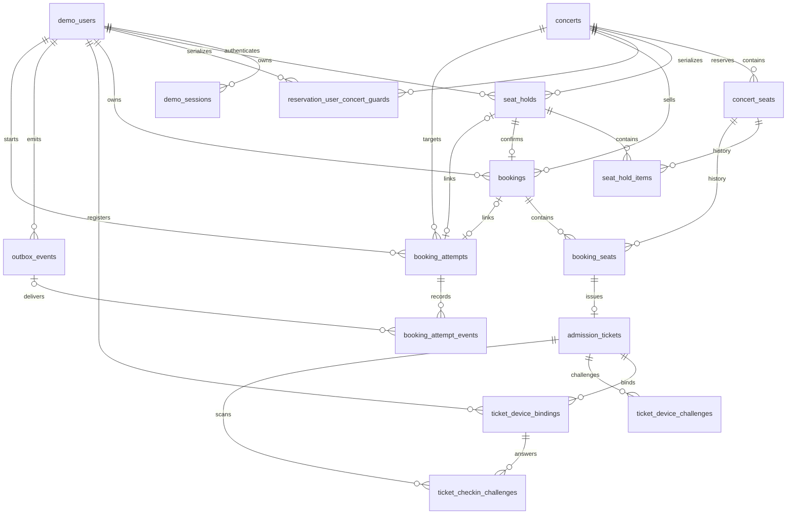

# Demo Ticketing DB 명세

## DB 경계와 시간

Demo는 `demo_ticketing_db`를 사용하며 기본 MySQL 포트는 localhost:3308이다. BTS의 localhost:3307/fairticket_db와 계정·볼륨·스키마를 공유하지 않는다. 테이블은 InnoDB이고 기본 문자 집합·정렬은 utf8mb4/utf8mb4_0900_as_cs다. opaque 식별자와 token hash에는 명시된 ascii/ascii_bin을 사용한다.

DATETIME에는 시간대가 없으므로 애플리케이션과 JDBC에서 UTC 원천으로 읽고 쓴다. 업무 시각은 DATETIME(6), 이벤트 발생 시각(outbox_events.occurred_at_utc, booking_attempt_events.occurred_at)은 DATETIME(3) 밀리초 단위다. BTS 전송 occurredAt은 밀리초까지의 UTC ISO 8601 Z 문자열이며 metadata.recordedAt은 소수 초를 포함할 수 있다.

## 관계

concert_seats.active_hold_id/active_booking_id는 현재 점유를 가리키고 item 테이블은 과거 이력을 유지한다. Outbox의 aggregate_id는 업무 그룹을 구분하는 문자열이며 FK가 아니다.

## 업무 테이블

| 테이블 | 주요 컬럼 | 무결성·조회 인덱스 |
|---|---|---|
| demo_users | id,public_user_id,bts_service_id,bts_external_user_id,bts_user_id,created_at | 공개 ID UNIQUE, (service,external ID) UNIQUE, BTS UUID UNIQUE |
| demo_sessions | id,user_id,token_hash,expires_at | user FK, hash UNIQUE, expiry INDEX; 24시간 세션 |
| concerts | id,public_id,title,artist,venue,start_at,end_at,price_from,tagline,hue | public_id UNIQUE, 종료>시작, 가격>=0, 0<=hue<360, 시작/공개 ID INDEX |
| reservation_user_concert_guards | user_id,concert_id | 복합 PK, user/concert FK; 동일 사용자의 공연별 예약 직렬화 |
| concert_seats | id,concert_id,seat_code,row_label,seat_number,grade,price,state,active_hold_id,active_booking_id,version | (공연,code)/(공연,row,number) UNIQUE, concert/hold/booking FK, (공연,state) INDEX |
| seat_holds | id,public_id,user_id,concert_id,status,expires_at,created_at | public_id UNIQUE, user/concert FK, 만료/소유자 INDEX |
| seat_hold_items | hold_id,concert_seat_id,price_snapshot | 복합 PK, hold/seat FK |
| bookings | id,public_id,user_id,concert_id,hold_id,status,total_price,공연 snapshot,booking_started_at,confirmed_at,booking_duration_seconds,payment_identifier,ip_address,created_at,cancelled_at | public_id/hold_id UNIQUE, user/concert/hold FK, 소유자·생성 시각 INDEX |
| booking_seats | booking_id,concert_seat_id,seat_code_snapshot,grade_snapshot,price_snapshot | 복합 PK, booking/seat FK |
| admission_tickets | id,public_id,booking_id,concert_seat_id,status,checked_in_at | public_id 및 (booking,seat) UNIQUE, booking_seats 복합 FK |

정확한 컬럼 정의·CHECK·FK 이름은 [schema.sql](../backend/db/schema.sql), [세션·Outbox 스키마](../backend/db/02-booking-support.sql), [동시성 스키마](../backend/db/03-seat-concurrency.sql)를 따른다. 03 스크립트는 기존 스키마의 guard 추가용이며 새 schema.sql에는 이미 반영되어 있다.

좌석 점유 CHECK는 AVAILABLE이면 두 참조가 NULL, HELD이면 hold만 존재, BOOKED이면 booking만 존재하도록 제한한다. hold 상태는 ACTIVE/RELEASED/EXPIRED/CONVERTED, 예매는 CONFIRMED/CANCELLED다. 같은 공연·좌석 관계와 현재 유효성은 서비스 트랜잭션에서도 검사한다. 취소·해제·만료 후에도 과거 item 이력은 보존한다.

예매의 제목·장소·공연 시작/종료 시각·좌석·가격은 snapshot이다. booking_duration_seconds는 사용 hold 생성부터 서버 확정까지의 0 이상 DECIMAL(18,6)이며 브라우저 체류 시간·대기열 시간을 대신하지 않는다. payment_identifier에는 허용된 테스트 식별자만 저장하고 ip_address에는 서버가 관측한 peer IP를 저장한다.

## 예매 시도 테이블

| 테이블 | 컬럼과 제약 |
|---|---|
| booking_attempts | attempt_id CHAR(36) ascii_bin PK; user_id/concert_id BIGINT NOT NULL FK; service_id VARCHAR(50); stage VARCHAR(30); status VARCHAR(20); sequence_no BIGINT; hold_id/booking_id nullable BIGINT FK 및 각각 UNIQUE; started_at DATETIME(6); ix_attempt_owner(user_id,concert_id,started_at) |
| booking_attempt_events | id BIGINT AUTO_INCREMENT PK; attempt_id CHAR(36) ascii_bin FK; transition_id VARCHAR(100) ascii_bin; sequence_no BIGINT; request_fingerprint CHAR(64); metadata JSON; occurred_at DATETIME(3); outbox_id nullable BIGINT FK; UNIQUE(attempt_id,transition_id), UNIQUE(attempt_id,sequence_no) |

request_fingerprint는 전이 내용의 SHA-256이다. 동일 transition의 같은 내용은 재사용하고 다른 내용은 충돌한다. sequence는 attempt 행 잠금 안에서 증가한다. outbox_id가 NULL인 journal은 주기 작업에서 Outbox에 연결한다. 업무 확정과 journal 완료는 예약 트랜잭션에서 원자적으로 처리하고 원격 전송은 분리한다.

## 티켓 기기 바인딩 테이블

admission_tickets는 변경하지 않는다. 검표는 기존 status(ISSUED→CHECKED_IN)와 checked_in_at을 그대로 쓴다.

| 테이블 | 컬럼과 제약 |
|---|---|
| ticket_device_bindings | id PK; public_id CHAR(36) ascii_bin UNIQUE(QR의 deviceId); ticket_id FK admission_tickets; user_id FK demo_users; status ACTIVE/REVOKED; generation INT(1=최초 등록, 변경마다 +1); public_key VARBINARY(128)(P-256 SPKI DER); totp_secret_enc VARBINARY(64) nullable; created_at; revoked_at; active_ticket_id 생성 컬럼; UNIQUE(active_ticket_id), UNIQUE(ticket_id,generation) |
| ticket_device_challenges | id PK; public_id CHAR(36) ascii_bin UNIQUE; ticket_id/user_id FK; challenge CHAR(43); expires_at; UNIQUE(ticket_id,user_id) |
| ticket_checkin_challenges | id PK; public_id CHAR(36) ascii_bin UNIQUE(checkInId); ticket_id FK admission_tickets; binding_id FK ticket_device_bindings; challenge CHAR(43); status PENDING/COMPLETED/REJECTED/SUPERSEDED; created_at; expires_at; resolved_at nullable; pending_ticket_id 생성 컬럼; UNIQUE(pending_ticket_id) |

- `active_ticket_id`는 status가 ACTIVE일 때만 ticket_id를 갖는 STORED 생성 컬럼이다. UNIQUE로 티켓당 활성 기기 1개를 DB가 보장한다.
- ck_device_status: ACTIVE는 암호화된 비밀키가 있고 revoked_at이 NULL, REVOKED는 비밀키가 NULL이고 revoked_at이 있다. 기기 변경 시 이전 행은 비밀키를 지우고 이력으로만 남는다.
- totp_secret_enc는 AES-256-GCM의 IV(12)‖암호문‖tag(16)이다. 키는 TICKET_SECRET_KEY이며 AAD로 ticketId:deviceId를 묶는다. 키를 바꾸면 기존 바인딩은 복호화할 수 없어 모두 기기 변경이 필요하다.
- 챌린지는 비밀이 아닌 난수이며 사용 시 행을 삭제한다. 새 챌린지 발급은 같은 티켓·사용자의 이전 행을 대체한다.
- ticket_checkin_challenges는 검표 스캔마다 생기는 일회성 챌린지다. `pending_ticket_id`는 status가 PENDING일 때만 ticket_id를 갖는 STORED 생성 컬럼이며 UNIQUE로 티켓당 미완료 챌린지 1개를 DB가 보장한다. 새 스캔은 이전 PENDING을 SUPERSEDED로 바꾼다. 종료는 `status='PENDING'` 조건부 UPDATE로 한 번만 일어난다. 만료는 행을 바꾸지 않고 expires_at으로 판단한다. 검표기가 결과를 조회하므로 종료된 행도 남기며, 같은 티켓의 다음 스캔 때 1시간이 지난 종료 행을 지운다.
- ck_checkin_challenge_status: PENDING은 resolved_at이 NULL, 나머지 상태는 resolved_at이 있다.
- 기기 등록·변경·검표는 해당 예매 행(bookings)을 FOR UPDATE로 잠가 예매 취소와 직렬화한다.
- 예매 취소는 바인딩을 건드리지 않는다. 취소된 티켓의 바인딩은 ACTIVE로 남지만 티켓 상태 때문에 검표·변경이 모두 거부된다.

정확한 정의는 [05-ticket-device-binding.sql](../backend/db/05-ticket-device-binding.sql)과 [07-checkin-challenges.sql](../backend/db/07-checkin-challenges.sql)을 따른다.

## Outbox

outbox_events는 id PK와 user_id FK, service_id, external_event_id, business_transition_id, aggregate_id, event_type, occurred_at_utc, metadata JSON, payload LONGTEXT, delivery_status, lease_token, locked_until, retries, next_attempt_at, bts_event_id, last_error_code, created_at, sent_at을 저장한다.

- UNIQUE(service_id,external_event_id), UNIQUE(business_transition_id,event_type).
- ck_outbox_type: BOOKING/CANCEL/CHECK_IN/BOOKING_ATTEMPT.
- ck_outbox_status: PENDING/IN_FLIGHT/RETRY/SENT/FAILED.
- ck_outbox_payload: payload IS NULL OR JSON_VALID(payload).
- 최종 payload는 UUID 결합 후 한 번 고정한다. LONGTEXT는 재전송 body를 보존하고 metadata JSON은 원천 구조를 유지한다.
- lease 기반 claim과 업무 그룹 순서, 재시도 정책은 [BTS 연동 명세](bts-integration.md)를 따른다.

## Redis 저장 구조

대기열용 MySQL queue_entries/admissions 테이블은 없다. `QUEUE_KEY_PREFIX:{공연 ID의 Base64URL}:` 아래 waiting/waiting-delayed, deadlines, admitted, expired, sequence를 사용한다. 같은 공연 키는 Redis Cluster hash tag를 공유한다. CAPTCHA challenge/grant/replay도 같은 공연 namespace에서 TTL을 가진 HASH로 관리한다. grant는 사용자·공연·정책 action에 묶이며 등록 시 원자적으로 소비한다.

## 스키마 적용

Hibernate ddl-auto=none, spring.sql.init.mode=never다. Compose는 새 빈 볼륨에서 schema/seed/02/03/04를 초기화하며 기존 볼륨을 자동 마이그레이션하지 않는다. [04-booking-attempts.sql](../backend/db/04-booking-attempts.sql)은 MySQL 8.0.16+에서 Demo DB에 한 번만 적용한다. 두 attempt 테이블 생성과 Outbox CHECK 교체를 포함하며 반복 실행용 IF NOT EXISTS 스크립트가 아니다.

[06-event-time-millis.sql](../backend/db/06-event-time-millis.sql)은 02·04가 적용된 기존 DB에만 한 번 적용한다(#44). outbox_events.occurred_at_utc와 booking_attempt_events.occurred_at을 DATETIME(3)로 넓히며 기존 값은 .000으로 유지된다. 새 볼륨은 이미 DATETIME(3)이므로 적용하지 않는다. BTS가 밀리초 occurredAt을 받는 버전(ticket-fds-admin #40)을 먼저 배포한다.

[05-ticket-device-binding.sql](../backend/db/05-ticket-device-binding.sql)도 같은 방식으로 한 번만 적용한다. 테이블 두 개를 추가할 뿐 기존 테이블·CHECK를 바꾸지 않으며, [07-checkin-challenges.sql](../backend/db/07-checkin-challenges.sql)은 05 다음에 한 번만 적용하며 ticket_checkin_challenges 테이블 하나를 추가한다. 05와 07을 모두 적용한 뒤 CHECKIN_ENABLED를 활성화한다. 절차는 [검표 실행 안내](../backend/scripts/README-TicketCheckIn.md)를 따른다.

적용 전 실제 DB 이름·기존 테이블·CHECK·백업을 확인하고 쓰기 작업을 중지한다. DDL은 개별 자동 commit되며 CHECK 교체는 메타데이터 잠금을 얻는다. 일부 실패 시 자동 재실행·임의 복구하지 말고 현재 스키마를 먼저 확인한다. 이미 적용된 DB에 재실행하거나 기존 업무 데이터·BTS 스키마를 초기화하지 않는다. 적용 후 BOOKING_ATTEMPTS_ENABLED를 명시적으로 활성화한다.
